# Assembly

Thirteen steps. In every picture the part going on **now is orange** and
what is already built is grey, so you never have to work out what changed.

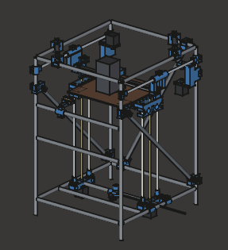

Everything printed and every piece of hardware, lifting off the conduit it
clamps to. The conduit itself stays put - that is the skeleton everything
else locates against.

## Before you start

- **Print one `Joint4_corner` and fit it to a real offcut first.** It is
  12 of the 48 printed pieces; if the bore is wrong you want to find out
  once, not 12 times. Raise `EMT_FIT` in `params.py` if it is tight.
- **Cut all the conduit first**, to the [cut list](README.md#emt-cut-list).
  Deburr the OUTSIDE of every cut: the clamp bore has only 0.23 mm of
  clearance per side, and a roll cutter leaves a raised lip.
- **Leave every clamp finger-tight until the step that says otherwise.**
  The frame has to be square before anything is locked.
- Nothing here needs a tap or a threaded insert. Every printed joint is a
  bolt through a clearance hole into a captive nut.

## Fasteners

Counted off the geometry - every bolt hole in every printed part, times
how many of that part you fit:

| Size | Qty | Mostly |
|---|---|---|
| M3 x 8-16 | 38 | motor screws, the MGN12 block, the toolhead |
| M4 x 25-30 | 101 | every conduit pinch clamp, one per clamp |
| M5 x 30 | 4 | the belt idler studs |

Plus a nut for each. **This is an over-estimate of a few bolts**: where two
printed parts bolt to each other, both have a clearance hole and both get
counted. Buy the round number.

| Printed part | M3 | M4 | M5 | Fitted |
|---|---|---|---|---|
| `Joint4_corner` | - | 3 | - | x12 |
| `FootPad` | - | 1 | - | x4 |
| `TeeZCross` | - | 2 | - | x4 |
| `BedMount` | - | 3 | - | x4 |
| `YRodBlock` | - | 1 | - | x4 |
| `ZMotorMount` | 4 | 4 | - | x2 |
| `BedCarriage` | 4 | 4 | - | x2 |
| `YCarriage` | - | 2 | 1 | x2 |
| `Gusset_side_low` | - | 2 | - | x2 |
| `Gusset_side_high` | - | 2 | - | x2 |
| `Gusset_cap_a` | - | 1 | - | x2 |
| `Gusset_cap_b` | - | 1 | - | x2 |
| `XCarriage` | 12 | - | - | x1 |
| `WipeBracket` | 2 | 1 | - | x1 |
| `CornerTower_R` | 4 | 1 | 1 | x1 |
| `CornerTower_L` | 4 | 1 | 1 | x1 |
| `Gusset_rear_low` | - | 1 | - | x1 |
| `Gusset_rear_high` | - | 1 | - | x1 |

## Step 1 - Posts, feet and the bottom rectangle

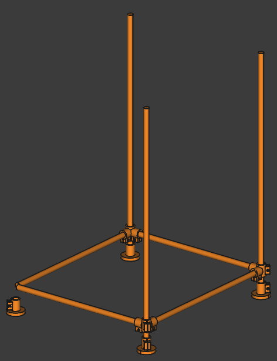

**Print:** 4 x `FootPad`, 4 x `Joint4_corner`

**Conduit:** 4 x 768 mm, 2 x 531 mm, 2 x 471 mm

**Fasteners:** 16 x M4

Thread EVERY corner clamp and foot onto the posts before you stand anything up - the bottom four, the cap four, and the four that go on later for the mid and wipe rails. They are one-piece sleeves with a pinch slot far narrower than the tube, so they will not clip on afterwards and the only way to add one is to take an end apart.

## Step 2 - The top cap rectangle

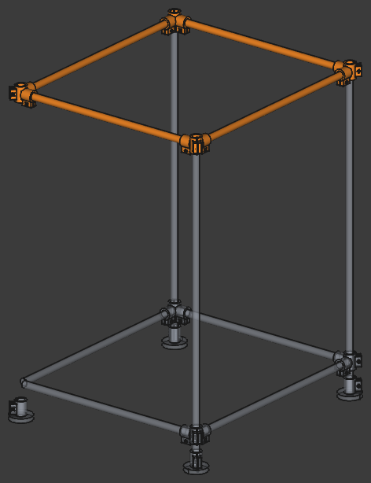

**Print:** 4 x `Joint4_corner`

**Conduit:** 2 x 531 mm, 2 x 471 mm

**Fasteners:** 12 x M4

Square the frame now, with a tape across both diagonals of the cap, before anything else is tightened.

## Step 3 - Diagonal bracing

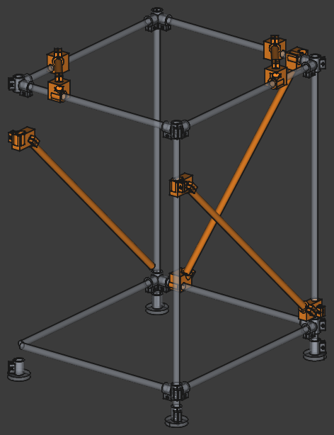

**Print:** 2 x `Gusset_cap_a`, 2 x `Gusset_cap_b`, 1 x `Gusset_rear_high`, 1 x `Gusset_rear_low`, 2 x `Gusset_side_high`, 2 x `Gusset_side_low`

**Conduit:** 1 x 698 mm, 2 x 519 mm, 2 x 166 mm

**Fasteners:** 14 x M4

This is what makes the frame a frame rather than a four-bar linkage. Do not skip it and do not leave it finger-tight.

## Step 4 - Front mid rail and the wipe rail

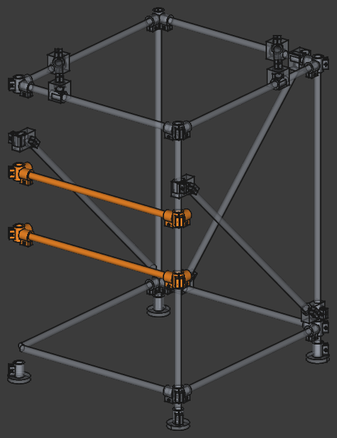

**Print:** 4 x `Joint4_corner`

**Conduit:** 2 x 471 mm

**Fasteners:** 12 x M4

The mid rail ties the front posts and carries the electronics; the wipe rail sits above it and carries the nozzle brush.

## Step 5 - Z cross rails, motor mounts and motors

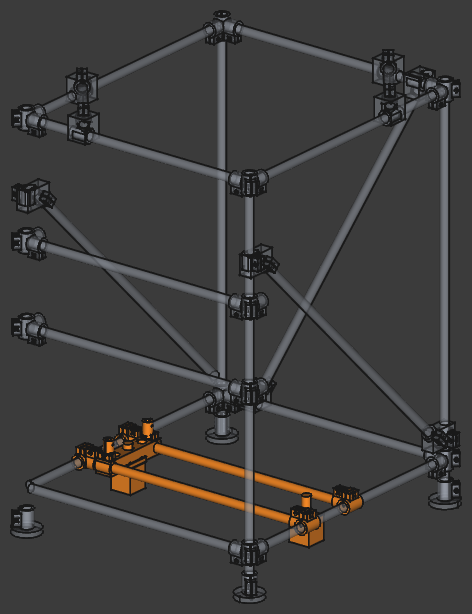

**Print:** 4 x `TeeZCross`, 2 x `ZMotorMount`

**Conduit:** 2 x 471 mm

**Fasteners:** 8 x M3, 16 x M4

Both Z motors run off ONE driver - wire them in SERIES, not parallel.

## Step 6 - Lead screws and Z rods

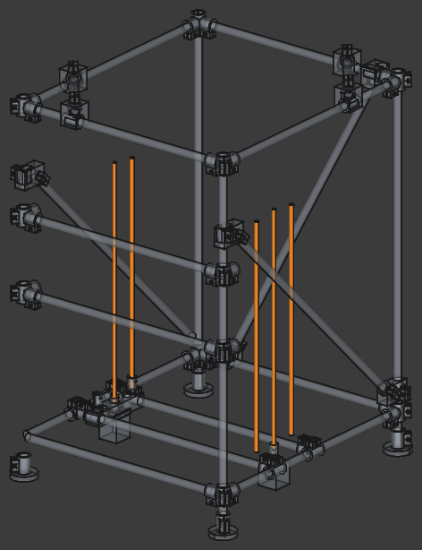

The rods cantilever from the motor mounts; they only resist pitch and yaw, the screws carry the weight.

## Step 7 - Bed carriages, mounts and the bed

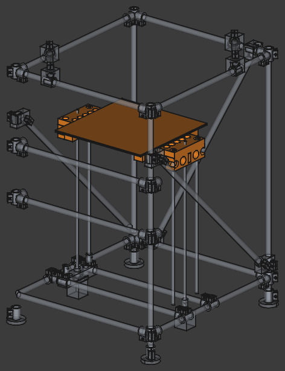

**Print:** 2 x `BedCarriage`, 4 x `BedMount`

**Fasteners:** 8 x M3, 20 x M4

BedMount reaches the heatbed's OWN 240 mm holes. Never drill a new hole in an aluminium heatbed - the heater is bonded to the underside.

## Step 8 - Y rods and their end blocks

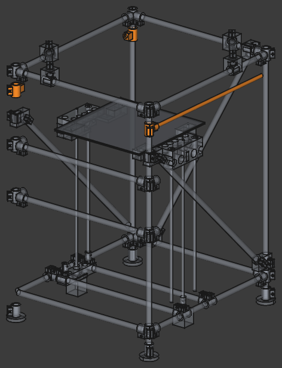

**Print:** 4 x `YRodBlock`

**Fasteners:** 4 x M4

Both rods must end up parallel and at the same height or the gantry will bind at the extremes of Y.

## Step 9 - A/B motors, rear idlers and the corner towers

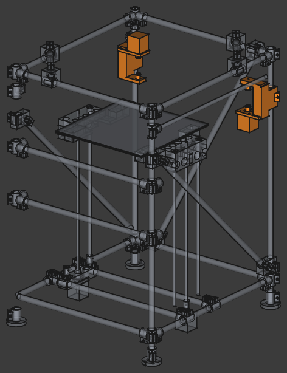

**Print:** 1 x `CornerTower_L`, 1 x `CornerTower_R`

**Fasteners:** 8 x M3, 2 x M4, 2 x M5

The two motors mount in OPPOSITE senses - A shaft-down with its body above its belt plane, B shaft-up with its body below.

## Step 10 - The gantry: Y carriages, 2020 beam and MGN12 rail

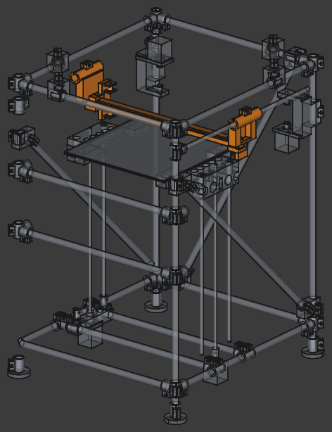

**Print:** 2 x `YCarriage`

**Fasteners:** 4 x M4, 2 x M5

Each Y carriage carries both belts' turn idlers on ONE stud, so the belt tensions apply no yaw couple.

## Step 11 - X carriage and toolhead

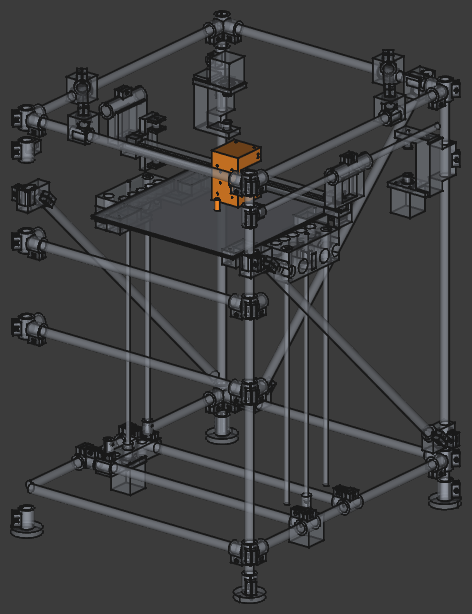

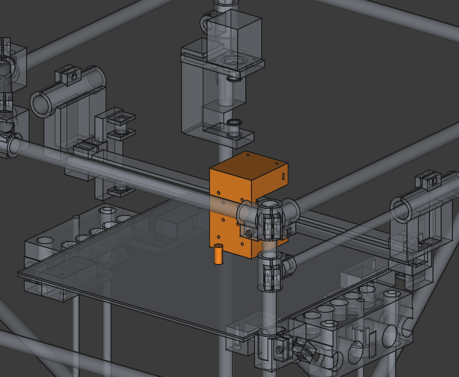

**Print:** 1 x `XCarriage`

**Fasteners:** 12 x M3

Check this bolt pattern against your real Stealthburner before printing a second XCarriage.

## Step 12 - Belts

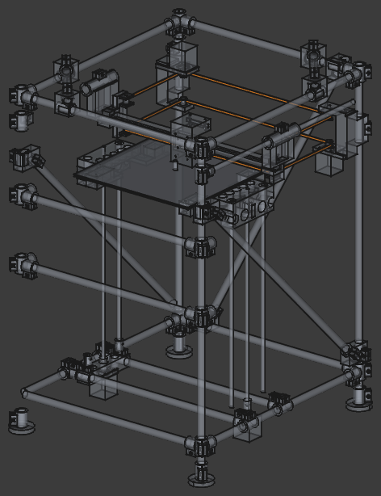

Both belts turn at the same point on each side, stacked in Z. Tension them equally - unequal tension racks the gantry.

## Step 13 - Nozzle wipe and purge station

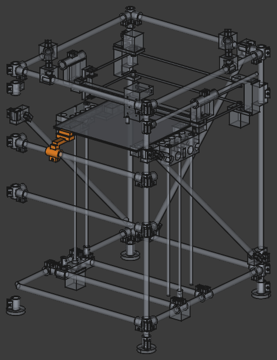

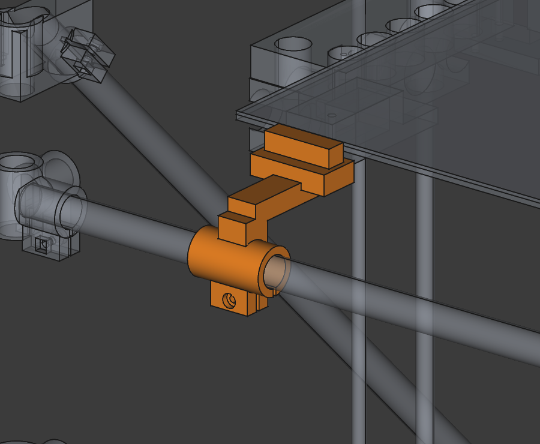

**Print:** 1 x `WipeBracket`

**Fasteners:** 2 x M3, 1 x M4

Everything here stays below the nozzle, because the gantry never lifts - this machine moves the bed in Z.

## When it is together

1. **Square the frame.** Measure both diagonals of the cap rectangle and
   both of the base. Equal means square. Only then tighten the braces.
2. **Check the gantry runs free** by hand over the whole of X and Y before
   the belts go on. It should coast, not grind.
3. **Level the two lead screws by hand**, motors unpowered, turning the
   couplers independently. There is no automatic tramming on this machine
   - both Z motors share one driver.
4. **Set the nozzle height** against the bed at several points and shim the
   bed mounts if the plate is bowed. A 3 mm plate of this size often is.
5. Flash Klipper, then work through the config in
   [README.md](README.md#wiring-the-skr-pico).

Full travel is X +-163.3 and Y +-182.0, which is larger than the 300 x 300
print area - the extra is what the nozzle wipe station lives in.
